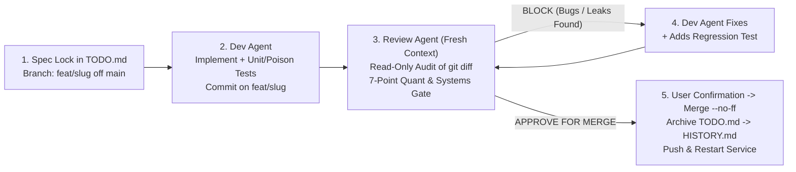

# `zy-quant` AI Agent Engineering & Workflow Skill

Authoritative operating manual for AI agents working in `/Users/yangzhang/Dev/zy-quant`. Read and follow this skill before planning tasks, creating branches, writing strategy/execution code, reviewing diffs, or merging to `main`.

---

## 1. Non-Negotiable Repository, Security & Git Rules

1. **Public GitHub Identity Only (`https://github.com/zyang21/zy-quant`):**
   - **NEVER** commit with a corporate/Apple email or `x509` (`ac-sign`) signature.
   - Before making the first commit in any session/worktree, perform a **read-only** check of local Git config (do **not** run mutating `git config` writes if values already match):
     ```bash
     git config --local --get user.name        # must be: zyang21
     git config --local --get user.email       # must be: zyang21@users.noreply.github.com
     git config --local --get commit.gpgsign   # must be: false
     ```
2. **Zero-Tolerance Secret & State Isolation:**
   - **NEVER** write `api_token`, `trade_pwd_md5`, `alpaca.api_key`, `alpaca.secret_key`, webhook URLs, or private LAN/Tailscale host IPs into tracked `config/settings.json` or any tracked source/test file.
   - Secrets belong **exclusively** in gitignored `config/settings.local.json` (`chmod 600`). `AppSettings.load()` enforces a hard `SECURITY BLOCK` exception if secret keys appear in `config/settings.json`.
   - Never stage or commit `data/*.db*`, `data/cache/`, `data/.manual_start`, `logs/`, or `.env`.
3. **Physical Environment Separation:**
   - Paper simulation (`SIMULATE`) writes strictly to `data/zy_quant_sim.db`.
   - Live brokerage (`REAL`) writes strictly to `data/zy_quant_real.db`.
   - Historical split-adjusted market bars (`WITHOUT ROWID` SQLite WAL) live in `data/cache/market_bars.db`.
4. **Python, Shell & Tooling Environment:**
   - Always execute Python, `pytest`, and CLI commands through the repo virtualenv (`.venv/bin/python`, `.venv/bin/pytest`, `.venv/bin/zy-quant`) managed by `uv`.
   - **English-Only Shell Rule:** Use **English only** (strictly zero Chinese characters) in all shell scripts (`deploy/*.sh`), shell comments, and terminal commands.

---

## 2. Quantitative & Broker Domain Guardrails (What to Notice During Feature Development)

Every strategy, adapter, risk-gate, or backtest change **must** respect these domain invariants:

1. **Zero Look-Ahead Bias (Strict Causality):**
   - Provider `1d` bars (e.g., Alpaca `YYYY-MM-DDT05:00:00Z` / `04:00:00Z`) store that day's **`16:00 ET` closing OHLCV** at a morning/midnight timestamp.
   - During any intraday or `session_day` evaluation, slice daily bars **strictly before `session_day`** (`bisect_left(daily_dates, cur_day)`, i.e., `b.timestamp.date() < cur_day`).
   - For near-close swing decisions (`15:35–15:55 ET`), construct a causal **`partial_1d_bar`** purely from `[09:30 ET .. decision_ts]` session bars appended to `<= T-1` completed `1d` bars.
   - **Mandatory Regression Test:** Any new signal, regime, or ranking feature must pass a **poison-bar test** (mutating `session_day`'s `16:00 ET` `1d` close to `$0.01` must produce 100% identical intraday/near-close signals, rankings, and PnL).
2. **Futu HK Brokerage Mechanics & Fee Realism:**
   - Target account is **Futu Securities Hong Kong (`FUTUSECURITIES`, SFC-regulated)**:
     - **Exempt** from US FINRA `$25,000` PDT restrictions (`is_pdt: 'N/A'`), supporting unlimited `T+0` when economically justified.
     - Governed by exact 2026 Futu HK fee floors (`~$1.99+` per whole-share leg via `FutuUSFeeModel`), which penalizes high-churn turnover on `$2.7k–$10k` capital and favors **low-frequency multi-week swing (`~25–45 trades/yr`)**.
   - **Server-Side Protective Stops (`FutuGatewayAdapter.place_or_update_protective_stop`):**
     - `futu-api` defaults `place_order()` to `TimeInForce.DAY` (`expires 16:00 ET`!). Multi-day/multi-week whole-share (`>= 1 sh`) protective stops **must** explicitly use **`TimeInForce.GTC`** + `OrderType.STOP` (or configured stop type) with `fill_outside_rth=False`, and re-sync share `qty` immediately after any partial scale-out so overnight triggers never flip short.
     - **Fractional Lot Constraint (`< 1.0 sh`):** Futu US fractional orders (`0.99%` fee capped at `$0.99`, `$0` comm/settlement) do **not** support server-side `STOP` or `GTC`; always route `< 1.0 sh` positions through the client-side RTH open/close stop monitor.
3. **US Market Timezone, Early Closes & Earnings Timing:**
   - Anchor all trading dates, blackouts, and session boundaries to **`ET_TZ` (`America/New_York`)** via `zy_quant.intel.market_hours` — never `datetime.now(timezone.utc).date()` (which rolls over at `19:00/20:00 ET`) or host local time (`Asia/Shanghai`).
   - Strip pre/post-market bars from `15m` series (`09:30–16:00 ET` normal; `09:30–13:00 ET` NYSE early-close days via `session_close_time()`).
   - Distinguish **`BMO` (Before Market Open -> act on `T-1` close, fail-safe default when timing is `UNKNOWN`)** from **`AMC` (After Market Close -> act on `T-0` close)** for pre-earnings rules.
4. **Survivorship-Bias, Volume Feed Parity & Cache Integrity:**
   - Multi-year backtests (`2021–2026`, especially across the **2022 bear market**) must enforce `PointInTimeUniverseFilter` so current-year winners (or post-2022 IPOs/spin-offs) do not leak hindsight bias into earlier years.
   - **Alpaca `IEX` vs. `SIP` Volume Parity:** Never mix unscaled real-time `IEX` share volume (`~2.5%` market share) directly against historical consolidated `SIP` (`100%`) volume in `RVOL` or `partial_1d_bar` calculations without per-symbol `SIP/IEX` & time-of-day volume calibration.
   - **Retroactive Split/Dividend Cache Guard:** Because `HistoricalBarCache` stores `adjustment="all"` split-adjusted bars, incremental tail-delta updates must verify overlap-bar price continuity (`<= 0.2%` drift) and re-sync the full symbol series on corporate actions.
5. **Concurrency, Idempotency & macOS Daemon Safety:**
   - Order state transitions (`ZyTradeOrderHandler` push callbacks + `reconcile_open_orders()` polling) must acquire `self._order_lock` and settle strictly by incremental `delta_shares = filled_shares - reconciled_shares`.
   - SQLite schema changes in `StateStore._init_db()` must be idempotent (`CREATE TABLE IF NOT EXISTS` + column existence checks before `ALTER TABLE`).
   - `launchd` runs `deploy/run_daemon.sh` with `WorkingDirectory=/tmp`: never assume `cwd` is repo root; never use interactive `sudo` inside daemon/stop scripts (use `sudo -n` with warning fallback); preserve `data/.manual_start` vs. scheduled `StartCalendarInterval` auto-exit semantics (`./deploy/stop.sh --superkill` completely uninstalls `launchd` + `pmset` on Dev hosts).

---

## 3. Backlog & Roadmap Lifecycle (`TODO.md` <-> `HISTORY.md`)

`TODO.md` is strictly the **active forward backlog**; `HISTORY.md` is the **immutable delivery ledger**.

### A. Creating or Updating Tasks in `TODO.md`
1. Update **`## Priority Legend`** at the top of `TODO.md` so priority order (`[P1]`, `[P2]`, `[P3]`, `[P5]`, ...) and `(Next Up)` tag match the active sections below.
2. Format every milestone section consistently:
   ```markdown
   ## `[Pn]` Concise Milestone Title
   **Target Branch:** `feat/<kebab-slug>`

   1–2 sentence objective explaining the quantitative/architectural "why" and key design tradeoffs.

   ### Functions & Tasks
   - [ ] **1. Component / Subsystem Name (`src/zy_quant/path/file.py`, `config/file.yaml`)**
     - [ ] Concrete, testable deliverable with explicit invariants and edge cases.
   ```
3. Before starting implementation on a milestone, review its math/architecture assumptions against existing `config/*.yaml` and `src/zy_quant/` contracts so parameter conflicts are caught at spec time.

### B. Moving Completed Tasks to `HISTORY.md` (Post-Merge Cleanup)
When a `[Pn]` milestone is approved, merged into `main`, and passes all tests:
1. **Remove** the completed `[Pn]` block (and its `Priority Legend` bullet, adding `[Pn]` to the archived list on line 3) from `TODO.md`.
2. **Carry over** any intentionally deferred out-of-scope check into the appropriate remaining `[Pm]` section in `TODO.md`.
3. **Append** a structured archive entry to `HISTORY.md`:
   ```markdown
   ## YYYY-MM-DD — `[Pn]` Milestone Title
   - **Branch / Commits:** `feat/<slug>` (`<feature_sha>`, merged in `<merge_sha>`)
   - **Delivered Scope:**
     - Bullet summary of modules, schemas, CLI/UI changes, and regression test counts.
   - **Verification / Quantitative Benchmark:**
     - `pytest` pass count + controlled A/B backtest or latency/smoke metrics (Net PnL, PF, Max DD, trade count).
   ```

---

## 4. Dual-Agent Feature Development Workflow (`Dev Agent` + `Review Agent`)

Every non-trivial feature or `[Pn]` milestone **must** use **two separate agents with isolated contexts** — one to build (`Dev Agent`) and a second independent agent (`Review Agent`) to audit before merging to `main`.



### Step 1 — Branch Creation (Clean Off `main`)
```bash
git checkout main
git pull --ff-only origin main
git checkout -b feat/<kebab-slug>   # Matches **Target Branch** in TODO.md
```
- Never commit feature work directly on `main`.
- Keep unrelated dirty files out of feature commits (`git status -sb` before staging).

### Step 2 — `Dev Agent` Responsibilities (Build & Self-Verify)
- Implement all checkbox items in the target `TODO.md` milestone, adhering strictly to project OOP structure (`gateway/`, `intel/`, `strategy/`, `risk/`, `runtime/`, `storage/`, `backtest/`, `web/`).
- Write comprehensive unit tests in `tests/` covering happy paths, boundary/fee floors, crash-recovery idempotency, and zero-lookahead poison-bar checks.
- Run full verification locally:
  ```bash
  .venv/bin/pytest -v
  bash -n deploy/*.sh   # whenever deploy scripts are modified
  ```
- Commit cleanly on `feat/<kebab-slug>` using conventional commit style (`feat(scope): summary` or `fix(scope): summary`) and produce a **Dev Handoff Summary** (`branch`, `HEAD SHA`, `git diff --stat main...HEAD`, `pytest` output, and any benchmark numbers).

### Step 3 — `Review Agent` Responsibilities (Fresh-Context Adversarial Audit)
Launch a **separate `Review Agent`** (`task` tool with fresh context, or dedicated review session) instructed strictly as **read-only** (must not edit files or commit). Instruct it to read `SKILL.md`, the target `TODO.md` milestone spec, and the branch diff (`git diff main...feat/<kebab-slug>`), and require it to audit all 7 gates:

| Gate | What the `Review Agent` Must Actively Try to Break |
| :--- | :--- |
| **`G1` Causality & Look-Ahead** | Any `bisect_right` / `<= session_day` leak of `16:00 ET` daily closes, future splits/constituents, unscaled `IEX` vs. `SIP` volume mixing, or un-lagged indicators? Poison-bar test present? |
| **`G2` Broker, Stops & Fees** | `TimeInForce.GTC` set on swing stops? `<1 sh` fractional lots guarded from `OrderType.STOP`? Stop `qty` synced after partial scale-out? `FutuUSFeeModel` exact on all legs? |
| **`G3` Calendar & Timezones** | All `.date()` calls anchored to `ET_TZ`? Early-close (`13:00 ET`) & RTH filters honored? `BMO` (`T-1`) vs. `AMC` (`T-0`) earnings timing handled safely? |
| **`G4` Risk & Sizing Math** | Does `ATR` timeframe (`1d` vs `15m`) match stop multipliers and `max_hard_stop_pct` without silent clamping? Portfolio heat & single-name/sector caps enforced? |
| **`G5` State, Locks & Recovery** | `_order_lock` + `delta_shares` idempotency intact under concurrent push + poll? SQLite migrations backward-compatible with existing `data/zy_quant_*.db`? |
| **`G6` Daemon, CLI & Deploy** | `WorkingDirectory=/tmp` imports clean? English-only shell scripts? `.manual_start` vs scheduled auto-exit preserved? Non-interactive `sudo -n`? Web API sanitized against secret leaks? |
| **`G7` Spec & Test Completeness** | Every bullet in `TODO.md` implemented and covered by deterministic automated tests (no network-flaky unit tests)? |

The `Review Agent` must return:
- Severity-ranked findings (`[CRITICAL]`, `[HIGH]`, `[MEDIUM]`, `[LOW]`) with exact `path/to/file.py:line` references and concrete failure scenarios, ending with **`VERDICT: BLOCK`** or **`VERDICT: APPROVE FOR MERGE`**.

### Step 4 — Fix & Re-Review Loop
- If `VERDICT: BLOCK`: the `Dev Agent` resolves every `[CRITICAL]`, `[HIGH]`, and agreed `[MEDIUM]` finding on `feat/<kebab-slug>`, adds a dedicated regression test for each bug found, re-runs `.venv/bin/pytest -v`, commits, and re-runs the `Review Agent` on the updated diff until **`VERDICT: APPROVE FOR MERGE`**.

### Step 5 — Merge to `main`, Backlog Archive & Runtime Sync
Once `Review Agent` approves and the user confirms merge:
1. Merge with `--no-ff` to preserve clean milestone history:
   ```bash
   git checkout main
   git merge --no-ff feat/<kebab-slug> -m "Merge branch 'feat/<kebab-slug>' into main"
   .venv/bin/pytest -v
   ```
2. Move the completed `[Pn]` milestone from `TODO.md` into `HISTORY.md` (Section 3B) and commit `docs(roadmap): archive [Pn] to HISTORY.md` (either on the feature branch right before merge or on `main`).
3. Push `main` (and feature branch if requested) to `origin`. **Only** restart the local background service if `com.zyquant.daemon` is intentionally enabled on this host (keep Dev Mac stopped via `./deploy/stop.sh --superkill` so it never competes with Prod `MacBook-Air.local` for `FutuOpenD` or submits duplicate orders):
   ```bash
   git push origin main
   if launchctl print "gui/$(id -u)/com.zyquant.daemon" >/dev/null 2>&1; then
     .venv/bin/zy-quant service restart
     curl -sS --max-time 5 http://127.0.0.1:8088/api/dashboard | .venv/bin/python -c "import sys,json; print(json.load(sys.stdin)['git_revision'])"
   fi
   ```
